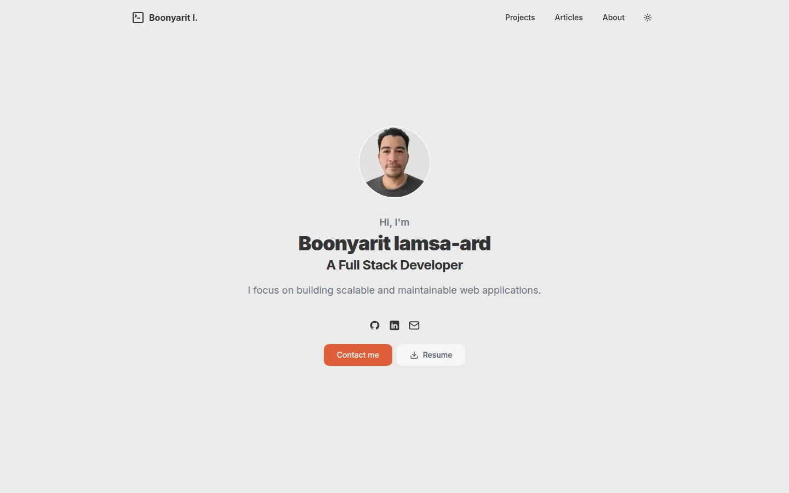
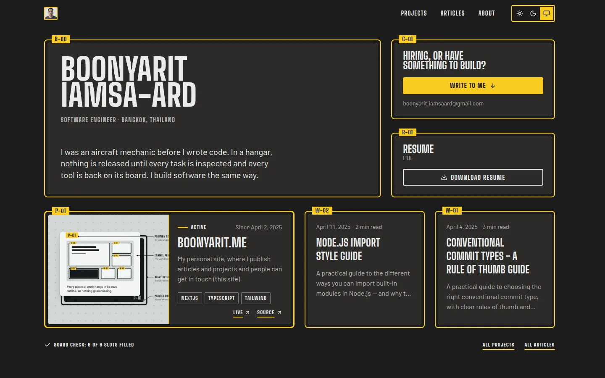
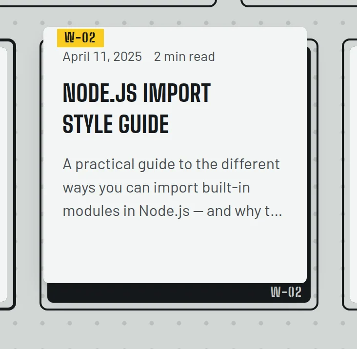
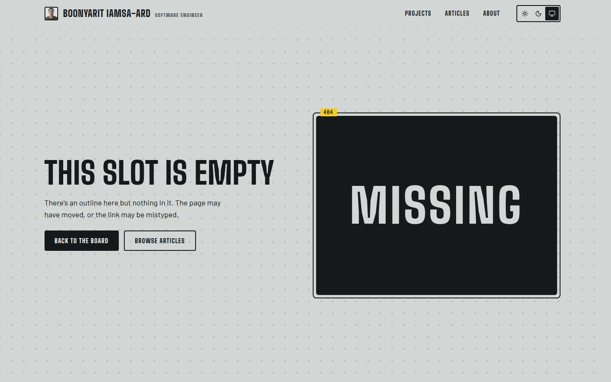
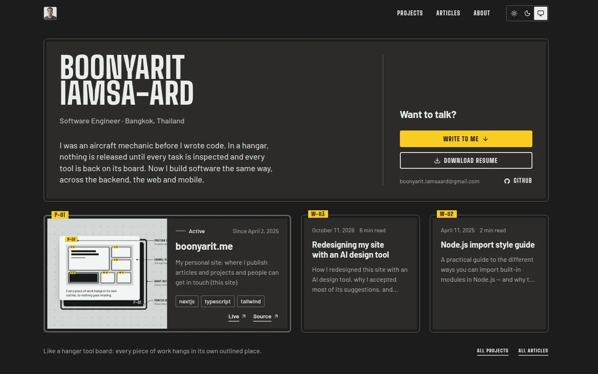

I can build a website, but I have never been trained in visual design. I can tell when a layout looks wrong. But I usually can't explain why, and I can't create a better one by myself.

So for this redesign, I worked with Impeccable, an AI design tool. It suggested designs and built the pages. I accepted most of its suggestions. My part was to check the reasons, try the result, and speak up when something did not fit.

Impeccable is a design skill that runs inside Claude Code, an AI coding agent. Other Claude Code sessions reviewed and fixed the work, and CodeRabbit reviewed the pull request. When I write "the tool" below, I mean Impeccable. When I write "an agent", I mean one of those other sessions.

## The old site

The old site was a simple stack of sections: a large round photo of me at the top, a row of cards that all looked the same, and a "Tools" grid of technology logos. The layout was familiar, but it could have been anyone's website.

The site was also out of date. The top of the home page still said Full Stack Developer, the title of my first role. The About page said Backend Engineer, my title at a later company. Neither matched my current job. I'm now a Software Engineer, so the site needed to say that in every place.

## What I told it at the start

The tool started with an interview. It asked six questions, and it took about five minutes.

Its first question came from reading the old site: was all of this still true? It wasn't, so I corrected my title. The other answers set the direction:

- **Who the site is for:** hiring teams and freelance clients first, with equal priority. Other engineers come second.
- **What must stay:** the contact form, the resume download, the light and dark themes, and the story of how I moved from aircraft maintenance to software.
- **The first feeling:** careful and reliable.
- **What would feel wrong:** too many tricks, a design that could belong to anyone, too much visual noise, or too much empty space.

One rule did not come from the interview. In an earlier session, an AI agent built a grid of technologies, like a skills section on a resume. I said no, and kept one rule: no logo grids and no lists of tool names. Describing the work I do was still fine.

## Why I chose the Shadow Board

The tool gave me eight design ideas. It picked one at random to consider: **The Drawing Set**. In this design, every page is a numbered engineering drawing. The tool warned that the site might look like it was pretending to be an engineering document.

The tool's own favorite was **The Shadow Board**. In a hangar, a shadow board is a wall for tools. Each tool hangs inside its own painted outline. At the end of a shift, you look at the board. If an outline is empty, a tool is missing, and you need to find it before it ends up somewhere dangerous, like inside an engine. I worked in front of that wall for years. I chose this direction in about ninety seconds.

Another idea helped shape the result. It was based on a panel of audio connections and suggested using different line styles instead of colours. On this site, the outline shows project status through solid lines, dashes, thick lines, or dashes and dots.

The Shadow Board also came with a warning: it could easily become another list of tools. That happened in the first build. The "What I build" section listed tool names by area, just with a new design. A review found it, and my earlier rule made the next step clear. The list became three short paragraphs, in my own words, about the work I do, with no tool names.

The cards also act like items on the board. When you move the pointer over a linked card or focus its title link with the keyboard, it lifts to show the painted outline and code underneath.

The 404 page uses the same idea. It is an empty slot on the board. The outline is still there, but the item is missing.

## Where I agreed, and why

After the build, the tool reviewed its own work. It suggested changes to the text sizes, colours and tape edges. It also reduced how often my name appeared and drew a new site icon and project cover. I accepted these changes.

The resume button is a better example of how I decided. The tool suggested giving it a border instead of a filled background on every page. At first, I thought this would make the resume too easy to miss. But in the dark theme, both the resume and "Write to me" buttons would otherwise be filled with yellow. They would compete for attention.

With only a border around the resume button, "Write to me" stands out. The resume is still easy to find next to it. The same order of importance works in the light theme, so I accepted the change.

Another change came from a rule I had already agreed to: each article should make sense to someone who never sees the home page. A reader may arrive directly from search or a shared link. So every article and project now ends with a contact section. It introduces me, mentions my mechanic background, and offers two actions: write to me or download my resume.

## Where I said no

**Balance between visitors.** In the middle of the build, I stopped the tool. The pages were mostly speaking to hiring teams, but freelance clients were supposed to be equally important. The contact section now asks, "Hiring, or have something to build?" That small change gives both groups a reason to get in touch.

**My photo.** During the build, I asked for my face to take up less space. I suggested a small photo in the header. Later, the final review asked for the large photo back because it was in the original design brief. The agent pointed to my earlier request and kept the small photo. The brief was then updated to match.

**Article headings.** The design used Big Shoulders, a narrow font, with all letters in capitals. Longer headings in a real article looked like shouting. I changed them to Barlow, the font used for the article text, with capitals only where a sentence needs them.

## Layers of review

Different checks found different problems. The most important one was not automated.

**Me, on my phone.** While checking the preview, I opened the menu and it closed straight away. I recorded my screen and shared the video. An agent found the cause and fixed it. It used Playwright, a browser testing tool, to show the menu failing before the fix and working after it.

The bug had been on the live site since June 28, before the redesign. A code change meant to satisfy an automated check had changed when the menu closed. The closing code was supposed to run when the visitor changed pages. It now also ran when the menu opened. The automated checks had passed, and earlier reviews had missed it. Trying the menu on my phone made the problem clear.

**The other checks.** Two review agents checked the first build, one against the project's coding rules and one against the design document. They found the submit button had no visible keyboard focus, and they found the list of tools. CodeRabbit then caught smaller problems in the pull request, mostly about accessibility.

Not every finding was right. One reviewer thought draft articles would leave gaps in the numbers on the board. The agent checked before changing anything. Drafts were already removed before the numbers were given, so no change was needed. A suggestion still needs checking, even when it comes from a review.

## Did it work?

I can't measure yet how visitors feel. I can only compare the result with what I asked for.

The old home page put my photo and title in the centre and left my work below the first screen. Now the first screen shows my latest project and articles next to the contact and resume, each in its own place. Project status is visible without colour. Even the 404 page tells you what is missing. To me, that feels careful. Whether it feels reliable is for visitors to decide.

## What I would do differently

The biggest lesson came from the review itself. There was an early design brief, but the detailed design document was written from the finished site. That document then became the reference for the agent review. So the review was partly checking the build against a description of itself. Checking against that document could confirm that the build matched it. It couldn't confirm that the design met what I needed in the first place.

Next time, I would write clear requirements before the build, so the review has something outside the build to check against.

I would also keep testing real tasks, such as opening the menu, reading an article and using the form with a keyboard. My phone found the worst bug because it didn't know what the design document said.

The tool brought the ideas. My experience gave me reasons to accept or challenge them, and that was enough to make this redesign my own. You can see the result on [the live site](https://boonyarit.me).

## Update, October 2026

After this article went out, I asked for a design review. The body text was fine, but the board around it was too loud. Every outline was as dark as the text, titles on pages and cards were in capitals, and the first screen had too many labels.

So I kept the board and made it quieter. The outlines are now thin and light, articles sit directly on the page, long titles use normal sentence case, and the day background is close to white, with no dots. Position codes now appear only on articles and projects, where they mean something.

The screenshots above show the board before it was made quieter. Here is the same page now.

