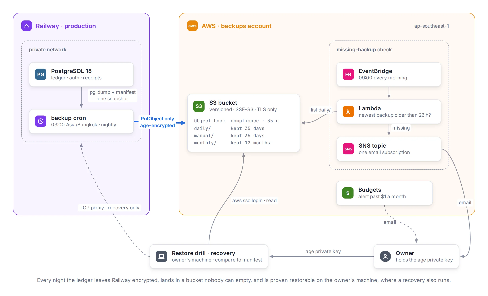

[Bookkeeping](/projects/bookkeeping) is the app where I record my household's money. It runs on Railway, and its PostgreSQL database holds every transaction I have entered since September.

In October I noticed a problem. Three weeks earlier, my trial data had turned into my real ledger. My own plan said real data had to wait until backups existed outside Railway. Nobody went back to the plan. So for three weeks, the only copy of my ledger lived with one provider, in one account.

What follows is what I built over the next two weeks, and the three tests that showed it works. One of those tests wasn't planned: Railway had a security incident in the middle of the work.

I built this with Claude Code, an AI coding agent. The agent wrote the code, the AWS template and the step-by-step runbooks. I made every decision, and I ran every step that needed a password or an AWS sign-in. The agent never held AWS credentials.

## Measure first

Before choosing a design, I ran one read-only query against production. The database was PostgreSQL 18.6 and 8.7 MB in size. After three weeks it held about 40 transactions, so about two a day.

At that rate, a nightly backup loses at most one day of entries, which for me means typing in two or three transactions again. That holds only while the nightly runs succeed: if one fails, the gap grows until I notice and fix it, which is why a check further down emails me the next morning. Point-in-time recovery, which replays every change up to a chosen second, is hard to set up on a managed Railway database. At my size, it would protect almost nothing extra. So the design is one encrypted dump a night, kept off Railway.

## Where the job runs

I chose AWS S3 for storage. I'm preparing for the AWS Solutions Architect Associate exam, and at this size the cost is close to zero. So the backup is also real practice with S3, IAM, Organizations, Lambda and CloudFormation.

The harder question was where the backup job runs. I compared three places:

- **AWS Lambda or GitHub Actions.** Both can reach AWS without a long-lived key, through IAM roles or OIDC. But both need the database open to the internet all the time, protected only by its password.
- **A cron service inside Railway.** The database stays on Railway's private network. The job needs one long-lived AWS key, stored in Railway.

I picked Railway. A key can be made harmless, but a public database cannot. The key belongs to an IAM user that can only add objects to the bucket. It cannot read, list or delete anything. If it leaks, the worst someone can do is add files. The incident later showed that adding files can do more harm than it sounds.

## Protection in layers

Every night at 03:00 Bangkok time, the job dumps the database and uploads it. Each layer protects against a different failure:

- **Encryption before upload.** The dump is encrypted with [age](https://age-encryption.org) using my public key before it leaves Railway. Neither Railway, AWS nor someone with the uploader key can read a backup. Only my private key can.
- **A lock nobody can open.** The bucket uses S3 Object Lock in compliance mode for 35 days. Nobody can delete or shorten the lock on a recent backup, not even the AWS account's root user. Governance mode would let an administrator remove it, so a stolen session of mine could still wipe recent backups.
- **A separate AWS account.** The bucket lives in its own account under an AWS Organization. The account has no root password or root keys at all. I sign in through IAM Identity Center with MFA, so my exam practice in other accounts can never touch the backups.
- **Retention.** Nightly backups stay 35 days, and the first backup of each month stays a year.

The private key is now the one thing I can't lose: without it, every backup is unreadable. It's stored in my password manager, and a second copy is encrypted with a passphrase on a cloud drive. I tested both copies before relying on them.

On the first day, I checked a new key by printing the key file, and the private key ended up in a screenshot I shared during the session. Nothing was encrypted to it yet, so the fix was cheap: a new key, the one manual dump encrypted again, and the old key treated as burned. Now I only ever print the public key.

## One snapshot, two files

Each nightly backup has two files: the encrypted dump, and an encrypted **manifest**. The manifest lists every table with its row count and a checksum of its rows.

Both files come from the same moment. The job opens a read-only transaction at the `REPEATABLE READ` isolation level, exports its snapshot, and points `pg_dump` at that same snapshot. Inside the same transaction, which keeps reading from that snapshot, it builds the manifest. So the dump and the manifest describe exactly the same data, even if I add a transaction while the backup runs.

Later, a restore can be checked against the manifest without ever connecting to production. If the restored tables match their counts and checksums, the backup is good.

The checksums needed one extra step. A row's text depends on session settings such as the time zone and the date format. The manifest query fixes those settings, so the same rows give the same checksum on my laptop as on Railway.

The first run took 7 seconds. The encrypted dump was 46.5 KB, and the manifest was 1.1 KB.

## The missing-backup alert

A nightly job that stops working without telling anyone is worse than no job, because I would believe I'm protected. So AWS checks for me. Every morning at 09:00 Bangkok, a small Lambda function looks for the newest nightly backup. If it's more than 26 hours old, it sends me an email.

The check runs in AWS, not Railway, so it still works when Railway is down. The 26 hours leave room for a late run without waiting two nights to notice.

I didn't trust an alert that had never fired, so I made it fire. I lowered the limit to one hour, so a healthy backup looked stale, and ran the function by hand. The email arrived within the minute. Then I put the limit back to 26 hours and read the setting back to confirm it.

Even the test had a timing rule. Run it within an hour after the nightly backup, and the backup is too fresh to look stale. Run it near the scheduled check, and the real check sends a real alert while the limit is one hour. The runbook named a safe window before I started.

Since then, the check has run every morning and has not sent a single false alarm.

## The restore drill

The next piece was a **restore drill**: a script I run on my own machine. It downloads the newest backup, decrypts it, restores it into a throwaway Postgres container with no network access, and compares the result with its manifest.

The container is removed when the drill ends, even if I press Ctrl-C. The dump flows from `age` straight into `pg_restore`, so no decrypted file is ever written to disk. The drill uses the same Postgres image as the nightly job, and the same manifest query, so a version bump moves both together.

Before trusting it, I made it fail on purpose. A changed row count, a changed row and a missing file each stopped the drill and named the reason. So did the planted-backup cases in the next section.

I wrote the drill on October 22, the day after the incident below, and the first real run passed that day: 10 tables matched.

## The incident

On October 21, Railway disclosed that a third party may have read customers' environment variables. My uploader key may have been one of them.

A leaked uploader key was a case I had designed for, so first I checked whether the design held. The key can't read or delete, so the existing backups were safe, and they were encrypted anyway. In the bucket, every file had one version and there were no delete markers. The key's only use was the nightly upload and one test of my own.

But the incident showed a gap I had missed. The key can't overwrite a backup, but on a versioned bucket it can add a newer version of the same file. My age public key is public by design. So someone holding the leaked key could create a fake backup with a matching fake manifest and upload it as the newest version. A simple drill would restore the fake and report success.

So the drill I wrote the next day refuses what looks planted:

- A backup whose files have more than one version, or any delete marker.
- A backup dated after today. Otherwise a planted backup with a future date would be the newest one, with a single version.

It also downloads each file by its version ID, so it restores exactly what it checked.

Then I replaced every secret Railway held: the database password, the app's auth secret and the uploader key. I replaced the key in an order that proved each step. I created a second key and put it into Railway, ran one backup by hand so the new key was the last one used, and only then turned off the old key. A week of clean nightly backups later, I deleted it. Railway never flagged my account, and I closed the incident on October 30 without their final report.

The new drill rule then caught a backup of mine. During the incident I ran two backups by hand, and each one added versions to that night's files. The drill refused it, correctly: three versions of a file is exactly what a planted backup looks like.

The fix was to give runs I start by hand their own folder. The nightly run starts at 20:00 UTC. A run that starts in any other hour writes to `manual/` with its start time in the name, and never touches the nightly files. I chose the clock over two other options. An environment variable would need a redeploy for every change, and forgetting to clear it would send the nightly runs to the wrong folder. A conditional upload that falls back to `manual/` would let a planted file push the real nightly backup aside.

## The recovery rehearsal

The drill proves a backup can be read, but not that I can put my ledger back into production. So the last test was a **recovery rehearsal**: the whole recovery, step by step, against a throwaway copy of production.

I created a temporary Railway project and loaded it with a recent backup, so it played the "damaged" production database. Then I followed the recovery runbook. It opens a temporary TCP proxy to the database, saves an encrypted copy of the damaged data, restores an older backup into a new database, and checks it against its manifest. Then it swaps the database names by hand, so the restored one becomes the live one. The decryption happens on my machine, so the private key never goes to Railway. The proxy is removed at the end, so nothing stays exposed after a recovery.

It took 22 minutes, and the restored database matched its manifest: 10 tables.

The rehearsal also found four things the runbook got wrong:

- Getting the public key from my key file failed, because the file is protected by a passphrase. The step now decrypts the file first.
- Railway's plain redeploy command found nothing to redeploy after an earlier step removed the deployment. The step now names the commit to deploy.
- Railway's docs explain how to add a TCP proxy, but not how to remove one. The runbook now says where to find it.
- The salvage steps, which read from the damaged database after the proxy is gone, worked over `railway ssh`. Before the rehearsal, that path was untested.

Each of these would have cost me time during a real incident, under stress.

## What it costs

| Item                         | Value                                 |
| ---------------------------- | ------------------------------------- |
| Database                     | 8.7 MB when I started                 |
| Encrypted nightly backup     | 48 KB on Oct 19, 71 KB on Nov 1       |
| Nightly run                  | 6 to 7 seconds                        |
| Kept                         | 35 days nightly, 12 months monthly    |
| Most data a failure can lose | one day, if the nightly run succeeded |
| Recovery rehearsal           | 22 minutes                            |
| AWS cost for October         | about $0.0009, estimated, for 14 days |
| Budget alert                 | at $1 a month                         |

The whole AWS cost for the backups account was less than a tenth of a cent, almost all of it S3.

## What it still doesn't cover

The design has limits I know about and accepted:

- **A short window for a planted backup.** A backup planted between midnight and 03:00 Bangkok, under that day's date, would be the newest backup with a single version until the nightly run lands next to it. A drill or recovery started in those three hours could pick it. Signing backups wouldn't help, because the signing key would sit in Railway next to the uploader key.
- **The checker never running.** The alert itself is proven: I made a healthy backup look stale and the email arrived within a minute. What nothing watches is the checker never running. A broken schedule produces no error, so the alarm stays green.
- **Two edges of the clock rule.** A run I start by hand during the 20:00 UTC hour still collides with the nightly run. And if Railway delays a nightly run past 20:59 UTC, it lands in `manual/`. The next morning's alert would report that one, so at least it fails loudly.
- **One person holds the key.** Recovery depends on me and my private key. That is fine for a household ledger, but it wouldn't be for a team.

## Where it ended

The reason for all of this was database migrations. My plan for production migrations relies on backups to undo a bad one, so migrations had to wait for a proven restore.

On October 31 they stopped waiting. I ran a backup by hand, which landed in `manual/`. Then production adopted its migration history, and migrations now run automatically before each API deploy. Running a backup by hand before merging a migration is now part of the process.

The next restore drill is on January 22, then every three months. On November 1, the first monthly backup appeared in the bucket, next to the nightly one, as planned.
